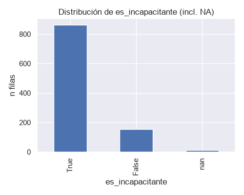
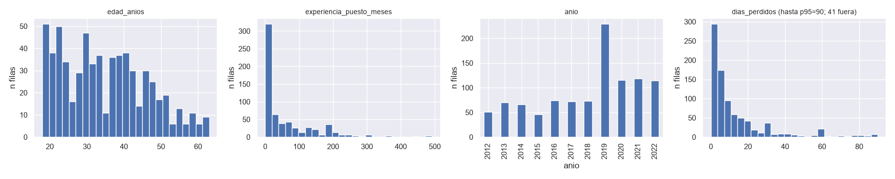
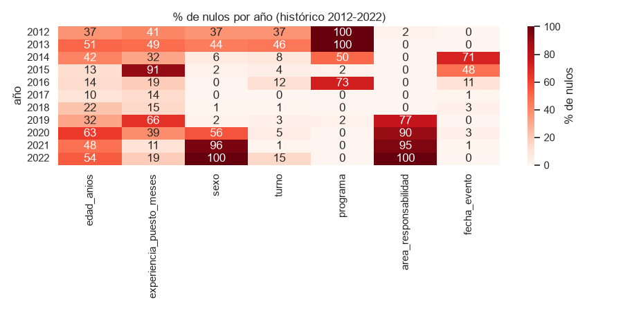
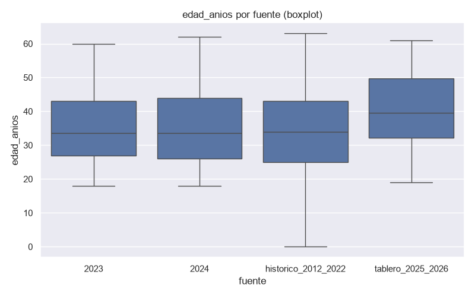
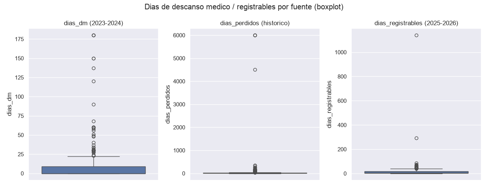

# Análisis Predictivo de Accidentes SST

Proyecto del curso de **Machine Learning Aplicado**, Ingeniería Industrial.

## 1. Problema central y contexto

El área de SST registra los accidentes que ocurren, pero no puede anticipar
cuáles van a derivar en días perdidos. Hoy, cuando se reporta un evento, el
jefe de SST necesita decidir cómo priorizar la atención y qué eventos escalar
a investigación a fondo, y esa decisión se toma por criterio del supervisor,
sin evidencia histórica que la respalde.

## 2. Objetivo del proyecto (medible)

Clasificar cada evento reportado como **incapacitante / no incapacitante**
con **recall ≥ 0.70 sobre la clase no incapacitante** (la clase minoritaria),
superando el baseline de predecir siempre la clase mayoritaria.

## 3. Tipo de problema de ML

**Supervisado, clasificación binaria.**

- Es supervisado porque el histórico ya trae, en la columna `gravedad`, el
  desenlace real observado de cada evento: no se busca estructura oculta en
  datos sin etiqueta, se tiene un objetivo definido y se quiere predecirlo.
- Es clasificación (no regresión) porque la variable objetivo es categórica
  con dos valores, no numérica continua.
- Es binaria (no multiclase) porque se colapsan las 12 categorías originales
  de `gravedad` en dos.
- Implicancia: métricas de clasificación (accuracy, precision, recall, F1,
  AUC-ROC) y matriz de confusión. Dado el desbalance de clases, **accuracy
  sola no sirve**: se prioriza recall y F1 sobre la clase minoritaria.

## 4. Variable objetivo (y): `es_incapacitante`

Booleana, derivada de la columna `gravedad` de
`data/processed/accidentes_historico_2012_2022.csv` (única fuente de las 5
que trae esta columna). `True` si el evento fue clasificado como
incapacitante (genera descanso médico), `False` si no incapacitante o
incidente.

**Reglas de agrupación**, implementadas en `src/clean.py`
(`derive_es_incapacitante`):

| Regla | Resultado |
|---|---|
| Contiene `INCAPACITANTE` sin `NO ` previo | `True` |
| `NO INCAPACITANTE` | `False` |
| `INCIDENTE` (y variantes mal escritas, incl. `INCICENTE`) | `False` |
| Cualquier otro valor (`-`, nulo, `DAÑO A LA SALUD`, `ACCIDENTE FUERA DEL TRABAJO`) | `NA`, excluido de entrenamiento, no se imputa ni se reclasifica |

Sobre las 1028 filas de `accidentes_historico_2012_2022.csv`: **861 `True`
(84.74%) / 155 `False` (15.26%)** con etiqueta definida, y 12 en `NA`
(excluidas de entrenamiento): el desbalance ~85/15 que el modelo deberá
tratar explícitamente. Ese 85/15 mezcla dos épocas: entre 2012 y 2018 los 452
registros son todos incapacitantes, y en **2019-2022** (población de
entrenamiento) la proporción es 72.5% / 27.5%.



**Por qué no se usó `gravedad` cruda ni `dias_perdidos > 0`:** `gravedad`
tiene 12 categorías, varias con 1-3 casos y errores de tipeo, no es
entrenable así. `dias_perdidos > 0` da un desbalance peor (93/7) y además
tiene 11% de nulos.

## 5. Variables predictoras (X)

Solo sobre `accidentes_historico_2012_2022.csv` (única fuente con `gravedad`,
por lo tanto la única usable para este target), **años 2019-2022** (564 filas con
etiqueta: 409 incapacitantes / 155 no): antes de 2019 todos los registros son
incapacitantes. Detalle en [reports/estrategia_data_preparation.md](reports/estrategia_data_preparation.md).

| Columna | Grupo | Incluida | Motivo |
|---|---|---|---|
| `edad_anios` | Persona | Sí | Conocida al momento del evento. 45% nulo: se imputa con la mediana de train, sin indicador de nulo |
| `sexo` | Persona | No | Disponibilidad ligada a la clase (33% con dato en incapacitantes vs. 91% en no incapacitantes) |
| `puesto_trabajo` | Trabajo | Sí | Conocida al momento del evento |
| `turno` | Trabajo | Sí | Conocida al momento del evento |
| `programa` | Trabajo | Sí | Conocida al momento del evento |
| `lugar` | Lugar | Sí | Conocida al momento del evento |
| `area_responsabilidad` | Lugar | No | 87% nulo en 2019-2022 |
| `fuente_peligro` | Evento | Sí | Conocida al momento del evento |
| `actividad_realizada` | Evento | Sí | Conocida al momento del evento |
| `mes` | Evento | Sí | Conocida al momento del evento |
| `anio` | Evento | No | No hay no incapacitantes antes de 2019; evita que el modelo aprenda la época |
| `experiencia_puesto_meses` | Persona | No | Disponibilidad ligada a la clase (82% con dato en incapacitantes vs. 6.5% en no incapacitantes). Derivada de `experiencia_puesto` por `clean.parse_experiencia_puesto()` ([detalle](reports/diccionario_datos.md#experiencia_puesto_meses)) |
| `dias_perdidos`, `dias_mas_ansi`, `parte_cuerpo_afectada`, `dano`, `cargo_ansi`, `nota_midot` | N/A | No | **Data leakage**: solo se conocen después del desenlace |
| `tipo_contacto` (100%), `nota_midot` (98.6%), `cargo_ansi` (97.7%), `modalidad` (95.7%), `nro_rom` (90%), `contrata` (73.3%) | N/A | No | Nulos >70%: el criterio de nulos manda sobre la relevancia conceptual |
| `nro_rom`, `id_persona` | N/A | No | Identificador, no predictor |
| `descripcion_accidente` | N/A | No, fuera de alcance de esta fase | Texto libre: requiere NLP (excede el curso) y puede contener nombres de trabajadores sin anonimizar |

## 6. Fuentes de datos

| Archivo (hoja) | Shape crudo | Shape procesado | Aporte |
|---|---|---|---|
| `Base de Accidentes 2023 _ Total.xlsx` (`Base`) | (306, 41) | `accidentes_2023.csv` → (107, 40) | Accidentes 2023. No tiene `gravedad`, no se usa para el target actual |
| `Base Accidentes 2024_Todo Alicorp.xlsx` (`Base`) | (281, 57) | `accidentes_2024.csv` → (281, 45) | Accidentes 2024. No tiene `gravedad`, no se usa para el target actual |
| `Resultados SST 2023 v06final.xlsx` (`HISTORICO ACCIDENTES`) | (1143, 26) | `accidentes_historico_2012_2022.csv` → (1028, 28) | **Fuente usada para X e y**, única con `gravedad` |
| `Tablero de Accidentes e incidentes.xlsx` (`2° Accidentes`) | (151, 44) | `accidentes_2025_2026.csv` → (151, 29) | Accidentes 2025-2026. No tiene `gravedad`, no se usa para el target actual |
| `Tablero de Accidentes e incidentes.xlsx` (`1° Incidentes`) | (343, 8) | `incidentes_2025_2026.csv` → (340, 9) | Incidentes (evento distinto a accidente) 2025-2026. No tiene `gravedad` |
| `BASE CALCULO INDICADORES 2024.xlsx` | N/A | No procesado | Indicadores ya agregados, sin registro fila-por-evento |

Los 5 CSV procesados están anonimizados (`id_persona` en vez de nombre/DNI) y
son commiteables. Detalle completo de columnas y decisiones de limpieza por
fuente en [reports/diccionario_datos.md](reports/diccionario_datos.md).

## 7. EDA

| Etapa | Notebook | Qué cubre |
|---|---|---|
| Data understanding | `00_inventario_fuentes` | Hojas, dimensiones, tipos y reporte de nulos de las 5 fuentes |
| Exploración general | `01_eda_accidentes` | Accidentes por mes/año, áreas y sexo (2023-2024); boxplots de outliers |
| Estadística descriptiva y valores faltantes | `03_estadistica_descriptiva` | Histórico 2012-2022: numéricas (media, mediana, percentiles, asimetría), categóricas (frecuencias, dominante, cardinalidad), nulos por columna y por año |
| EDA dirigido al target | `02_eda_dirigido` | 6 preguntas: distribución de `es_incapacitante`, correlación de Pearson, Cramér's V, tasa de incapacitantes por año y turno |

Principales hallazgos de `03_estadistica_descriptiva`:

- **Asimetría**: `experiencia_puesto_meses` (mediana 21 vs. media 61 meses) y
  `dias_perdidos` (máximo 4500) tienen colas largas hacia valores altos.
- **Nulos por año**: `sexo` pasa de ≤6% de nulos (2014-2019) a 96-100% en
  2021-2022; `area_responsabilidad`, de ≤2% (2012-2018) a 77-100% desde 2019;
  `programa` está vacío en 2012-2013.
- **Cardinalidad**: `puesto_trabajo`, `lugar` y `fuente_peligro` tienen 344-371
  categorías, cerca de 75% con un solo registro.
- **Grafías duplicadas**: `SETIEMBRE`/`SEPTIEMBRE` en `mes`.




Los puntos a resolver en la preparación de datos están al final de
`03_estadistica_descriptiva.ipynb`. Las decisiones de limpieza se registran en
[reports/diccionario_datos.md](reports/diccionario_datos.md).

## 8. Preparación de datos

Transformaciones que aplica hoy el código (ninguna imputa nulos salvo la
excepción marcada, ninguna hace deduplicación, encoding ni escalado):

| Transformación | Dónde |
|---|---|
| Renombrado de columnas a snake_case | `src/ingest.py`, diccionarios `_RENAME_*`, vía `.rename()` en cada `load_*()` |
| Eliminación de filas sin dato real | `load_base_accidentes("2023")`: descarta 199 filas sin `Fecha` (306→107); `load_accidentes_tablero`/`load_incidentes`: `dropna(how="all")` |
| Eliminación de columnas artefacto | `load_base_accidentes("2024")` descarta columnas `Unnamed`; `load_accidentes_tablero` descarta 14 columnas de seguimiento no interpretables + 3 de identidad |
| Parseo de fechas | `_parse_mixed_excel_date()` (serial de Excel + texto DD/MM/AAAA, `errors="coerce"`) |
| Coerción numérica | `pd.to_numeric(errors="coerce")` sobre columnas numéricas declaradas |
| Normalización de categóricas | `clean.normalize_categorical()`: mayúsculas, sin tildes, dtype `category` |
| Mapeo de booleanos | dict `_BOOL_MAP` (`SI`/`SÍ`→`True`, `NO`→`False`) vía `.map()` |
| Anonimización | `clean.anonymize_column()`: SHA-256 truncado a 12 car., salt fijo del proyecto |
| Imputación | Ninguna, salvo `es_recategorizado` (2024): blanco→`False` porque es un casillero tipo flag, no un dato faltante |
| Derivación de `es_incapacitante` | `clean.derive_es_incapacitante()`, reglas en la sección 4 |
| Derivación de `experiencia_puesto_meses` | `clean.parse_experiencia_puesto()`: texto libre → meses; lo ambiguo (sin unidad, comparaciones, valores concatenados, texto sin explicar) queda en `NA`, no se adivina (ver [diccionario](reports/diccionario_datos.md#experiencia_puesto_meses)) |
| Manejo de outliers | Se reportan todos (IQR, `clean.report_outliers_iqr()`) y se visualizan (boxplot); solo se corrigen a `NA` los que violan una regla de negocio verificable (ver detalle abajo) |

**Outliers: qué se corrigió y qué no (regla: solo se toca lo que viola una
regla de negocio verificable, nunca un valor solo por ser estadísticamente
extremo):**

| Corregido a `NA` | Regla de negocio |
|---|---|
| `edad_anios <= 0` (histórico, 4 filas) | Una edad de 0 es imposible para un trabajador |
| `tiempo_experiencia_meses` donde `/12 > edad_anios` (2024, 2 filas) | Nadie tiene más años de experiencia que de vida |
| `dias_perdidos`/`dias_mas_ansi == 6000` (histórico, 4 filas) | Mismo valor exacto repetido en accidentes no relacionados: más compatible con un tope/placeholder del sistema que con un dato real |

**Sin corregir a propósito** (extremos estadísticos sin regla de negocio que
los marque como error): `dias_dm`, `dias_dm_total_indicador`, `nota_midot`,
`dias_registrables`, `tiempo_empresa_meses`/`tiempo_empresa_anios`. Capar o
eliminar estos solo por ser grandes sería inventar un criterio, no corregir
un error confirmado.




Más boxplots en `reports/figures/outliers_boxplot_*.png`
(`01_eda_accidentes.ipynb`). Detalle completo en
[reports/diccionario_datos.md](reports/diccionario_datos.md#6-valores-atípicos-outliers).

Justificación completa de cada decisión en la sección *Bitácora de
decisiones* de [reports/diccionario_datos.md](reports/diccionario_datos.md).

## 9. Estado actual y qué sigue

> **Fase 1: ingesta, EDA y limpieza, sin modelado aún.**

Las 5 fuentes de `data/raw/` fueron auditadas; 4 están procesadas y
anonimizadas en `data/processed/` (1567 accidentes + 340 incidentes). El
problema, el target (`es_incapacitante`) y las X candidatas están definidos
(secciones 1-5), y el EDA dirigido (`02_eda_dirigido.ipynb`, 6 preguntas con
figuras en `reports/figures/`).

**Hecho en este hito:**

*Target y variables predictoras*
- [x] Derivación de `es_incapacitante` (`clean.derive_es_incapacitante`); las
      2 filas ambiguas de `gravedad` (`DAÑO A LA SALUD` / `ACCIDENTE FUERA
      DEL TRABAJO`) quedan en `NA`, sin reclasificar ni eliminar.
- [x] `experiencia_puesto` normalizada a `experiencia_puesto_meses`
      (`clean.parse_experiencia_puesto`) y agregada a X.
- [x] Sinónimos de `turno` agrupados (`normalize_turno`); se difiere el
      agrupamiento de `lugar`/`fuente_peligro`/`puesto_trabajo` por falta de
      criterio de dominio verificable.
- [x] Columnas booleanas (`es_considerado`, `es_recategorizado`,
      `es_hard_stop`, `es_verificado`) retipadas a `boolean` nullable.

*Calidad de datos*
- [x] Outliers con regla de negocio verificable corregidos a `NA`
      (`edad_anios`, `tiempo_experiencia_meses`,
      `dias_perdidos`/`dias_mas_ansi`, sección 8); el resto se documenta sin
      modificar.
- [x] Columnas con más de 80% de nulos se mantienen en `data/processed/` sin
      eliminar en esta fase.
- [x] Revisión humana de 132 filas de texto redactado detectó 6 fugas
      residuales de PII; corregidas en `clean.redact_pii_libre()` y
      verificadas sobre las 5 fuentes (detalle en el diccionario de datos).

*EDA*
- [x] EDA dirigido: 6 preguntas (Pearson, Cramér's V, tasas de
      incapacitante) con hallazgos documentados.
- [x] Estadística descriptiva, distribuciones y valores faltantes del
      histórico (`03_estadistica_descriptiva`).
- [x] Notebooks ejectuados.

*Data preparation*
- [x] Estrategia definida en
      [reports/estrategia_data_preparation.md](reports/estrategia_data_preparation.md):
      población 2019-2022, X final, nulos, duplicados, outliers, escalado,
      encoding y partición 80/20 sin fuga de información.

**Siguiente:** implementar esa estrategia en `src/` (limpieza, pipeline y
partición reproducible) y generar el conjunto de train y test.

Dato aparte: `BASE CALCULO INDICADORES 2024.xlsx` es el único archivo de
`data/raw/` que no se procesó, son indicadores ya agregados (no fila por
evento), así que no aporta registros nuevos para modelar.

## Estructura de carpetas

```
.
├── data/
│   ├── raw/          # Data original de la empresa, SOLO LECTURA. Nunca se modifica ni se commitea.
│   ├── interim/       # Data intermedia (pasos de limpieza en curso).
│   └── processed/     # Data final, lista para EDA/modelado.
├── notebooks/
│   ├── 00_inventario_fuentes.ipynb   # Inventario y primer vistazo a las fuentes crudas.
│   ├── 01_eda_accidentes.ipynb       # Análisis exploratorio de datos (2023-2024).
│   ├── 02_eda_dirigido.ipynb         # EDA dirigido a la variable objetivo.
│   └── 03_estadistica_descriptiva.ipynb  # Estadística descriptiva y valores faltantes (histórico).
├── src/
│   ├── config.py      # Rutas del proyecto y constantes (sin hardcodear rutas absolutas).
│   ├── schema.py       # Definición del esquema de columnas (nombres, tipos, categorías).
│   ├── ingest.py        # Carga de los archivos crudos (.xlsx) a DataFrames.
│   └── clean.py         # Funciones de limpieza y normalización reutilizables.
├── reports/
│   ├── figures/                # Gráficos exportados del EDA.
│   └── diccionario_datos.md    # Diccionario de datos y bitácora de decisiones de limpieza.
├── .github/
│   └── pull_request_template.md
├── CLAUDE.md            # Reglas del proyecto para trabajo asistido por IA.
├── pyproject.toml
└── .gitignore
```

Los notebooks solo importan funciones de `src/` y muestran resultados; la
lógica reutilizable (carga, limpieza, validación de esquema) vive en `src/`.

## Instalación y ejecución (con `uv`)

```bash
# 1. Instalar dependencias (crea el entorno virtual automáticamente)
uv sync

# 2. Levantar Jupyter para trabajar los notebooks
uv run jupyter lab

# 3. Lint (opcional, antes de commitear)
uv run ruff check .
```

## Flujo de ramas

```
main (protegida)
  └── develop
        └── feature/<nombre-de-la-tarea>
```

- Todo trabajo nuevo sale de `develop` en una rama `feature/*`.
- No se commitea directo a `develop`: se abre Pull Request desde `feature/*` hacia `develop`.
- `main` se actualiza solo desde `develop`, vía PR revisado.

### Convención de commits

Se usa [Conventional Commits](https://www.conventionalcommits.org/):

```
feat: agregar función de carga de accidentes 2024
fix: corregir dtype de columna fecha_evento
chore: actualizar .gitignore
docs: documentar diccionario de datos
```

## Confidencialidad de la data

La data en `data/` proviene de una empresa real y es **confidencial**:

- **`data/raw/` y `data/interim/` nunca se versionan**, en ningún formato
  (`.gitignore` los ignora por completo, más `*.xlsx`/`*.xls` en cualquier
  carpeta como red de seguridad extra).
- **Única excepción:** los `.csv` finales y **anonimizados** en
  `data/processed/` sí se pueden commitear. Ver el flujo completo de
  limpieza, guardado y anonimización en [CONTRIBUTING.md](CONTRIBUTING.md)
  antes de subir uno.
- Antes de compartir cualquier salida (notebook, figura, reporte, `.csv`),
  anonimizar nombres, DNI y legajos (hash o ID sintético, con
  `clean.anonymize_column`).
- **Checklist antes de cualquier `git add` / `git push`:**

  ```bash
  git ls-files data/   # solo debe listar .csv dentro de data/processed/
  ```

  Si aparece algo de `data/raw/`, `data/interim/`, o un `.xlsx`/`.xls`,
  **no hacer push** y avisar al equipo.
