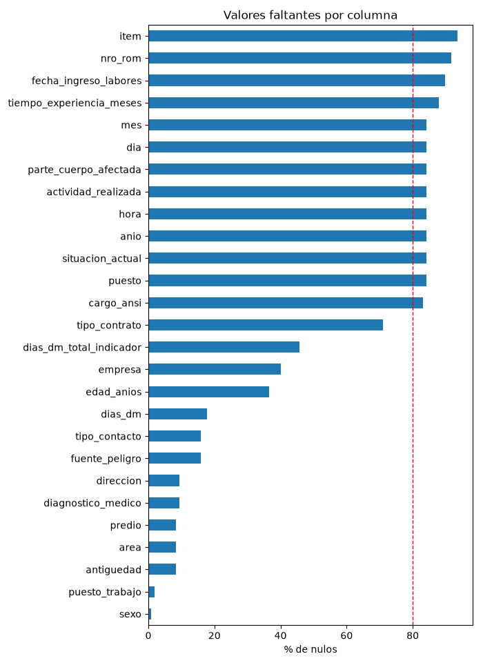
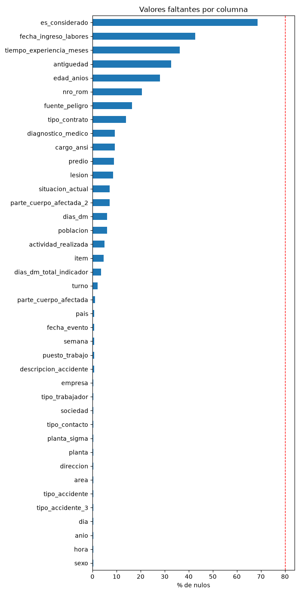
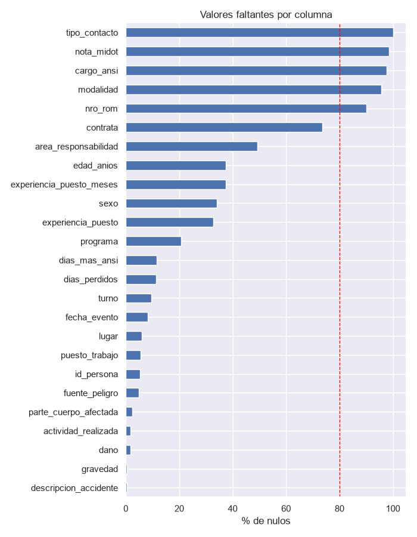
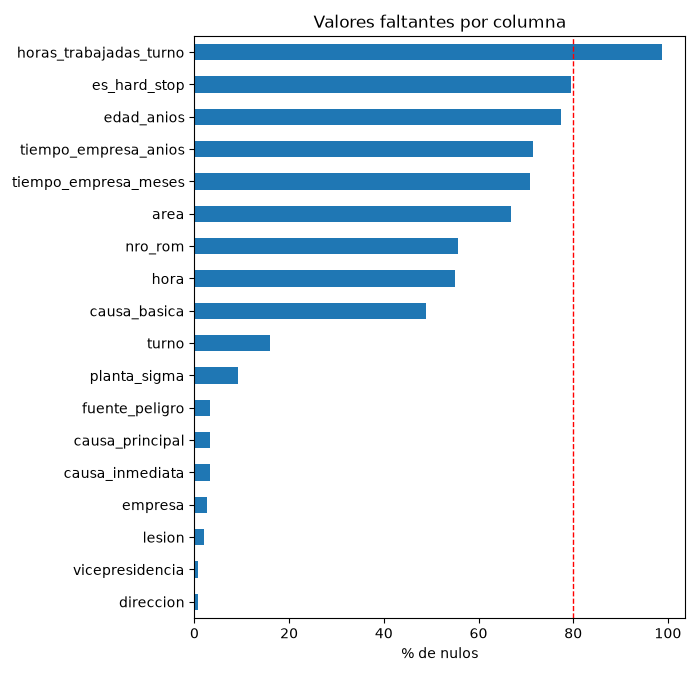
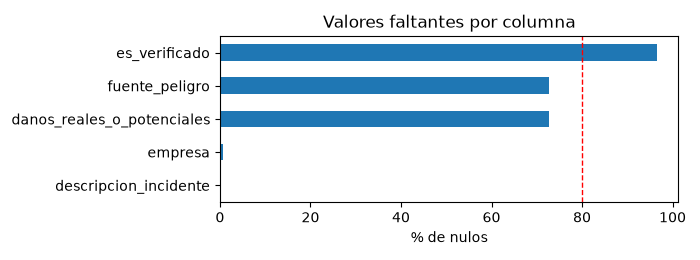
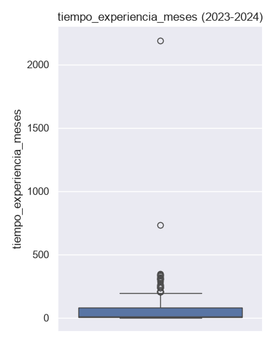

# Diccionario de datos

Define cada columna de `data/processed/` y registra toda decisión de
limpieza (imputación, eliminación, recodificación) con su justificación,
como exige `CLAUDE.md`. Ninguna limpieza se aplica en `src/` sin quedar
documentada aquí primero.

Las 5 fuentes de `data/raw/` fueron auditadas. Solo `BASE CALCULO
INDICADORES 2024.xlsx` queda sin procesar: son indicadores ya agregados
(no fila por evento), así que no aporta registros nuevos para modelar.

No se usó un muestreo por confidencialidad: esta ya se resuelve por fila,
con `id_persona` anonimizado (ver sección 6). Reducir filas no protegería
más a nadie y sí perjudicaría la calidad del modelo.

## 1. Fuentes y archivos procesados

| Archivo crudo (hoja) | Procesado como | Filas | Columnas |
|---|---|---|---|
| `Base de Accidentes 2023 _ Total.xlsx` (`Base`) | `accidentes_2023.csv` | 107 de 306 | 40 |
| `Base Accidentes 2024_Todo Alicorp.xlsx` (`Base`) | `accidentes_2024.csv` | 281 | 45 |
| `Resultados SST 2023 v06final.xlsx` (`HISTORICO ACCIDENTES`) | `accidentes_historico_2012_2022.csv` | 1028 (2012-2022) | 28 |
| `Tablero de Accidentes e incidentes.xlsx` (`2° Accidentes`) | `accidentes_2025_2026.csv` | 151 | 29 |
| `Tablero de Accidentes e incidentes.xlsx` (`1° Incidentes`) | `incidentes_2025_2026.csv` | 340 | 9 |
| `BASE CALCULO INDICADORES 2024.xlsx` | No procesado | Indicadores agregados, sin registro fila por evento | |

Notas rápidas:

- En `Base de Accidentes 2023`, las 199 filas que se descartaron eran
  residuo de formato de Excel (solo la columna `Sem` traía valor).
- En `HISTORICO ACCIDENTES` se excluyen las filas con `anio >= 2023` para
  no duplicar `accidentes_2023.csv` y `accidentes_2024.csv`.
- En `2° Accidentes` el encabezado real está en la fila 2 del Excel
  (`header=1`), y se descartaron 14 columnas de seguimiento con códigos
  mixtos que no se pudieron interpretar con confianza (ver sección 7).
- `1° Incidentes` no trae nombre, apellido ni DNI de ninguna persona.

Los 5 CSV son commiteables (anonimizados, `id_persona` en vez de
nombre/DNI). No se combinaron en un solo archivo porque sus esquemas no
son idénticos entre fuentes; se mantiene trazabilidad por fuente con la
columna `fuente_archivo`.

## 2. Columnas del dataset

Común a `accidentes_2023.csv` y `accidentes_2024.csv` salvo que se indique
lo contrario. Fechas parseadas con `errors=coerce`: lo que no se puede
parsear queda en `NA`, no se inventa.

| Columna | Tipo | Descripción | Notas |
|---|---|---|---|
| `item` | float | Correlativo del registro original | 93% nulo en 2023 |
| `nro_rom` | str | Código interno de trámite (ej. `ITD23107`) | No es dato personal |
| `pais`, `sociedad`, `predio`, `planta`, `direccion`, `area` | category | Ubicación/organización | |
| `planta_sigma` | category | Código de planta (sistema Sigma) | Solo 2024 |
| `tipo_accidente`, `tipo_accidente_2`, `tipo_accidente_3` | category | Clasificación del accidente | Solo 2024 |
| `fecha_evento` | datetime64 | Fecha del accidente | |
| `semana`, `dia`, `mes`, `anio` | float | Descomposición de la fecha | Redundante con `fecha_evento`, se mantiene por si el Excel traía inconsistencias entre ambas |
| `hora` | object | Hora del accidente | |
| `turno` | category | Turno de trabajo | |
| `tipo_trabajador`, `empresa` | category | Tipo de trabajador y empresa | |
| `sexo` | category | Sexo del trabajador | |
| `edad_anios` | float | Edad del trabajador | |
| `puesto_trabajo` | category | Puesto de trabajo | |
| `fecha_ingreso_labores` | datetime64 | Fecha de ingreso | 43-90% nulo |
| `descripcion_accidente` | str (texto libre) | Descripción narrativa | Redactada por PII, ver sección 6 |
| `tipo_contacto` | category | Mecanismo del accidente | |
| `parte_cuerpo_afectada`, `parte_cuerpo_afectada_2` | category | Parte del cuerpo afectada | |
| `actividad_realizada` | category | Actividad que se realizaba | |
| `proceso` | category | Proceso productivo | Solo 2023 |
| `diagnostico_medico`, `lesion` | category | Diagnóstico y tipo de lesión | |
| `dias_dm` | float | Días de descanso médico | |
| `cargo_ansi` | category | Clasificación de cargo, norma ANSI | |
| `dias_dm_total_indicador` | float | Días de DM para el indicador oficial | Valores no numéricos (ej. `Por confirmar`) pasan a `NA` |
| `situacion_actual` | category | Situación actual del caso | |
| `tiempo_experiencia_meses` | float | Experiencia del trabajador, en meses | |
| `puesto` | category | Puesto (adicional a `puesto_trabajo`) | Solo 2023 |
| `antiguedad` | category | Antigüedad del trabajador | |
| `fuente_peligro`, `tipo_contrato` | category | Fuente de peligro y tipo de contrato | |
| `poblacion` | float | Dotación asociada | Solo 2024 |
| `es_considerado` | boolean | Si cuenta para el indicador oficial | Solo 2024. Nulo cuando el Excel no lo especificaba |
| `es_recategorizado` | bool | Si fue recategorizado | Solo 2024. Blanco en el Excel se interpretó como `False` (es un casillero tipo flag, no un dato faltante) |
| `id_persona` | str | Hash del trabajador, ver sección 6 | |
| `fuente_archivo` | str | `2023` o `2024`, para trazabilidad | |

### Columnas propias del histórico (`accidentes_historico_2012_2022.csv`)

Esquema completo en `src/schema.py` (`ESQUEMA_HISTORICO`). Solo se detallan
las columnas que no son evidentes por su nombre.

| Columna | Notas |
|---|---|
| `tipo_contacto` | 100% nula: esta columna no existía en el Excel antes de 2023 |
| `gravedad`, `dano`, `contrata`, `nota_midot`, `modalidad` | Sin equivalente en 2023/2024, no se forzó un mapeo |
| `fecha_evento` | 8.3% en `NaT` por errores de tipeo en el Excel original (meses o años inválidos). No se adivinó ninguna fecha |
| `id_persona` | Hash de la columna `NOMBRE` (viene junta, no separada en apellidos). 5.25% nula: el Excel no traía nombre en esas filas |
| `programa` | Sede o programa productivo (ej. `GALLETERA LIMA`, `COPSA`). 20.7% nula |
| `lugar` | Sede física donde ocurrió el evento. Distinta de `area_responsabilidad`. 6.0% nula |
| `experiencia_puesto` | Texto libre (ej. `7 años y 10 meses`), sin transformación. Ver `experiencia_puesto_meses` abajo |
| `experiencia_puesto_meses` | Derivada de `experiencia_puesto`, X del modelo. Ver sección 4 |
| `dias_perdidos`, `dias_mas_ansi` | Días de descanso médico; análogas a `dias_dm` / `dias_dm_total_indicador` de 2023/2024 |

### Columnas propias de `accidentes_2025_2026.csv` (hoja `2° Accidentes`)

| Columna | Notas |
|---|---|
| `es_hard_stop` | Única columna de seguimiento que se conservó (valores `SI`/`NO` limpios) |
| `id_persona` | Combina apellidos, nombre y DNI antes de hashear |
| `vicepresidencia`, `categoria` | Línea de negocio / dirección |
| `dia_semana`, `trimestre` | Redundantes con `fecha_evento` |
| `causa_basica`, `causa_principal`, `causa_inmediata` | Metodología SCAT. Variantes de redacción casi idénticas no se unificaron (quedan como categorías distintas) |

### Columnas propias de `incidentes_2025_2026.csv` (hoja `1° Incidentes`)

Es la única de las 5 fuentes sin `id_persona`: no trae ningún dato de
identidad. `tipo_evento` incluye una variante mal escrita (`INDICENTE`) que
no se unificó con `INCIDENTE`. `es_verificado` es 96% nula.

## 3. Variable objetivo: `es_incapacitante`

Booleana, derivada de `gravedad` (única fuente que la trae) por
`clean.derive_es_incapacitante()`:

| Regla sobre `gravedad` | Resultado |
|---|---|
| Contiene INCAPACITANTE sin NO inmediatamente antes | `True` |
| Contiene NO INCAPACITANTE | `False` |
| Contiene INCIDENTE (incluida la variante mal escrita INCICENTE) | `False` |
| Cualquier otro valor (`-`, nulo, ACCIDENTE FUERA DEL TRABAJO, DAÑO A LA SALUD) | `NA`, no se imputa |

Sobre las 1028 filas del histórico: 861 `True`, 155 `False`, 12 en `NA`
(excluidas de entrenamiento). `gravedad` tiene 12 categorías distintas
(varias con 1-4 casos y errores de tipeo), por lo que no es entrenable sin
esta derivación.

**La población usada para entrenar no es el histórico completo.** Entre
2012 y 2018 el 100% de las filas con etiqueta son incapacitantes: el
registro de casos no incapacitantes empieza recién en 2019. Por eso el
modelo se entrena solo con 2019-2022 (564 filas, 72.5% / 27.5%). Detalle
completo en `reports/estrategia_data_preparation.md`.

## 4. Variables predictoras y su derivación

Ver la tabla completa de X incluidas/excluidas en el README, sección 5.
Aquí solo se documenta la derivación de las que no vienen directo del
Excel.

### `experiencia_puesto_meses`

`experiencia_puesto` es texto libre con unidades mezcladas (años, meses,
semanas, días, errores de tipeo). `clean.parse_experiencia_puesto()`
convierte a meses todo lo verificable y deja en `NA` lo ambiguo, sin
adivinar:

- Se convierte: años (x12), meses (x1), semanas y días (aprox. 1 mes = 30
  días), la expresión `y medio` y errores de tipeo reales encontrados en
  la data (`ños` por `años`, `mese` por `meses`, `DIAW` por `DIAS`).
- Queda en `NA`: vacío o `-` (38 filas), un número suelto sin unidad (no
  se puede saber si son días, meses o años), comparaciones sin límite como
  `MENOS DE 1 AÑO`, valores concatenados con `/` o salto de línea, y texto
  sobrante que no se puede explicar tras extraer la unidad reconocida.

De 692 valores no nulos, 644 (93.1%) se convirtieron; los 48 restantes se
revisaron uno por uno. Se aplicó la misma regla ya usada en 2023/2024:
nadie tiene más experiencia que años de vida (0 filas la violan aquí).

## 5. Valores faltantes

No se imputa ningún nulo todavía: quedan como `NA`/`NaT` en
`data/processed/`. Detalle completo por columna con `clean.report_nulls(df)`
(notebook `00_inventario_fuentes`) y por año en `03_estadistica_descriptiva`.

En el histórico, el % de nulos depende del año: `sexo` y
`area_responsabilidad` pasan de casi completos a 95-100% nulos entre 2019
y 2022. Esto es relevante para el modelo (ver sección 4 y la estrategia de
data preparation).

Las columnas con más de 80% de nulos en cualquiera de los 5 archivos
(`item`, `nro_rom`, `cargo_ansi`, `tipo_contacto`, `nota_midot`,
`modalidad`, `horas_trabajadas_turno`, `es_verificado`, entre otras) se
mantienen en `data/processed/` sin eliminar: en esta fase no se restringe
el dataset. La decisión de excluirlas de un modelo se toma al definir X
(ver README, sección 5).

## 6. Valores atípicos (outliers)

Se detectan con la regla del rango intercuartílico (IQR), sin eliminar ni
capar nada automáticamente. Solo se corrige a `NA` lo que viola una regla
de negocio verificable; un valor extremo no es, por sí solo, un error:

| Corregido a `NA` | Regla de negocio | Filas |
|---|---|---|
| `edad_anios` <= 0 (histórico) | Una edad de 0 es imposible para un trabajador | 4 |
| `tiempo_experiencia_meses` / 12 > `edad_anios` (2024) | Nadie tiene más años de experiencia que de vida | 2 |
| `dias_perdidos` / `dias_mas_ansi` = 6000 (histórico) | Mismo valor repetido en accidentes no relacionados: más compatible con un tope del sistema de origen que con un dato real | 4 |

Sin corregir a propósito (extremos estadísticos sin regla de negocio que
los marque como error): `dias_dm`, `dias_dm_total_indicador`, `nota_midot`,
`dias_registrables`, `tiempo_empresa_meses`/`tiempo_empresa_anios`. Capar o
eliminar estos solo por ser grandes sería inventar un criterio.

**Pendiente de revisión con SST:** los valores `6000` que se pasaron a
`NA` podrían no ser todos un error de digitación. `cargo_ansi` usa valores
estándar (60, 75, 100, 135, 175, 200, 300, 400, 3000, 4500, 6000); uno de
los casos corregidos es un accidente con gravedad `MORTAL` y
`cargo_ansi = 6000`, lo que sugiere un dato real, no un placeholder. Los
otros tres (sin `cargo_ansi` registrado) sí parecen un error de tipeo.

## 7. Privacidad: anonimización y PII

### Anonimización de identidad

| Fuente | Columnas originales | Método |
|---|---|---|
| Accidentes 2023/2024 | Apellido paterno, apellido materno, nombres | Hash SHA-256 (`clean.anonymize_column`), truncado a 12 caracteres, salt fijo del proyecto |
| Histórico | Columna `NOMBRE` (sin separar) | Mismo método |
| Accidentes 2025-2026 | Apellidos, nombre y DNI | Mismo método (el DNI se descarta tras usarlo) |

El mismo salt se usa en las 3 fuentes: un trabajador que aparece en más de
una queda con el mismo `id_persona`, lo que permite cruzar sus accidentes
sin exponer su identidad. Incidentes 2025-2026 no tiene `id_persona`
porque no trae ningún dato de identidad.

### Incidente de PII (2026-09-12)

Una auditoría encontró PII sin anonimizar en dos lugares que no eran
columnas de identidad: 8 celdas con nombre completo de una persona en
`area_responsabilidad`/`contrata` del histórico, y nombres de personas
(más un DNI) dentro del texto libre de `descripcion_accidente` e
`descripcion_incidente`, en hasta 40.6% de las filas de alguna fuente.
Esta data ya estaba en `develop` desde antes de la auditoría (PR #4): el
incidente no fue introducido por este hito, se descubrió al construir el
EDA dirigido.

Se corrigió así: las 8 celdas puntuales pasaron a `NA`, y se creó
`clean.redact_pii_libre()` para enmascarar nombres y DNI/RUC en las
columnas de texto libre (reemplaza por `[NOMBRE]` o `[DNI]`/`[RUC]`).

**Es una heurística, no un NER validado.** Puede enmascarar nombres de
lugar o empresa que también están en Título-Caso (se prioriza no dejar
pasar un nombre real sobre preservar esos términos), y puede no detectar
un nombre fuera del patrón esperado.

### Revisión humana de la redacción (2026-09-17)

Se revisó a mano una muestra de 132 filas de texto redactado. Se
encontraron 6 filas con fuga real (nombres de una sola palabra o con
título, y menciones repetidas de una persona ya identificada en la misma
fila), que el patrón original de 2 a 4 palabras en Título-Caso no cubría.
Estas fuentes ya estaban públicas en GitHub, así que la corrección se
priorizó.

Se amplió `redact_pii_libre()`: secuencias de hasta 6 palabras, título más
un nombre (`Sr. Muñoz`), rol más un nombre (`el colaborador Carlos`), el
patrón `Nombre (Accidentado)`, y propagación dentro de la misma fila
(si `Robinson Vilchez` ya se enmascaró, una mención posterior solo como
`Vilchez` también se enmascara). Verificado antes y después sobre las
≈1993 filas de texto libre de las 5 fuentes: 34 cambiaron de resultado,
revisadas una por una.

**Limitación conocida, sin resolver:** un apellido con conector en
minúscula (ej. `David de la Cruz`) solo enmascara la primera palabra.
Permitir conectores como `de`/`la`/`los` en el patrón aumentaría mucho el
riesgo de fusionar frases genéricas no relacionadas. Cerrar esto por
completo requiere un NER validado, no una heurística de regex.

No se reescribió el historial de git por este incidente: el commit con la
corrección deja el estado actual limpio hacia adelante, y reescribir
historial es una operación que exige coordinación de todo el equipo.

## 8. Bitácora de decisiones

Todas las decisiones de esta sección fueron aprobadas por el equipo antes
de implementarse en `src/`.

### Limpieza estructural (2026-08-28 a 2026-08-30)

- Se eliminaron las 199 filas residuo de `Base de Accidentes 2023` y las
  columnas `Unnamed` vacías de `Base Accidentes 2024`.
- `dias_dm_total_indicador`: valores no numéricos (ej. `Por confirmar`)
  pasan a `NA` por coerción, en vez de inventar un número.
- `es_recategorizado` (2024): el blanco del Excel se interpretó como
  `False` (casillero tipo flag), no como dato faltante.
- Filas con `anio >= 2023` del histórico se excluyeron para no duplicar
  `accidentes_2023.csv`/`accidentes_2024.csv`.
- `Fecha` del histórico, 85 filas con error de tipeo, pasaron a `NaT` en
  vez de adivinar la fecha.
- Se eliminaron 18 columnas de seguimiento de `2° Accidentes` (cierre de
  investigación, difusión de lecciones, contadores `T1`/`T2`) por traer
  códigos mixtos que no se pudieron interpretar con confianza.
- Se confirmó con el equipo no aplicar ningún muestreo de filas por
  confidencialidad (ver introducción de este documento).

### Anonimización

- Apellidos, nombres y DNI (las 3 fuentes que los traen) se reemplazaron
  por `id_persona` y se eliminaron del dataset limpio (sección 7).

### Reglas de negocio sobre outliers (2026-09-12)

- `turno` (fila 920) y `experiencia_puesto` (filas 12 y 36) del histórico:
  3 celdas traían el mismo texto que `gravedad` de su propia fila (una
  celda mal pegada en el Excel, confirmado fila por fila que no era un
  corrimiento de columnas). Se corrigió solo la celda, no el resto de la
  fila.
- `turno` del histórico: sinónimos agrupados de 21 a 7 categorías
  (`clean.normalize_turno()`). No se unificó el esquema numerado
  (`TURNO_1/2/3`) con el de franja horaria (`DIA`/`TARDE`/`NOCHE`) porque
  sería inventar una equivalencia de negocio no verificable. El marcador
  `-` (32 filas) se recodificó a `NA`, mismo criterio que en `sexo`.
- `edad_anios`, `tiempo_experiencia_meses`, `dias_perdidos`/`dias_mas_ansi`:
  ver tabla de la sección 6.
- Columnas con más de 80% de nulos: se mantienen en `data/processed/` sin
  eliminar en esta fase (sección 5).
- `lugar`, `fuente_peligro`, `puesto_trabajo` del histórico (344-371
  categorías): se difiere su agrupamiento, mismo motivo que `turno`
  (agruparlas requiere criterio de dominio de SST que no está disponible).

### Variable objetivo y población de modelado

- Las 2 filas ambiguas de `gravedad` (`ACCIDENTE FUERA DEL TRABAJO` y
  `DAÑO A LA SALUD`) quedan en `NA`, sin reclasificar ni eliminar
  (2026-09-12).
- `experiencia_puesto_meses` pasa a ser X del modelo (2026-09-17, sección 4).
- Población de entrenamiento: solo años 2019-2022, no el histórico
  completo (2026-09-20, sección 3).
- Se excluyen de X `experiencia_puesto_meses`, `sexo`, `area_responsabilidad`
  y `anio`, porque en 2019-2022 su disponibilidad depende de la clase
  objetivo; imputarlas haría que el modelo aprenda cómo se registró el
  dato, no el riesgo real. Se mantiene `edad_anios` (45% nula) imputada
  con la mediana de train (2026-09-20). Detalle completo en
  `reports/estrategia_data_preparation.md`.

### Privacidad (2026-09-12 a 2026-09-17)

- Incidente de PII detectado y corregido; ver sección 7.
- No se reescribe el historial de git por este incidente (2026-09-17).
- `redact_pii_libre()` ampliada tras la revisión humana de 132 filas; ver
  sección 7.
